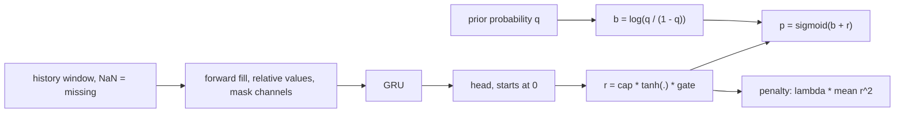
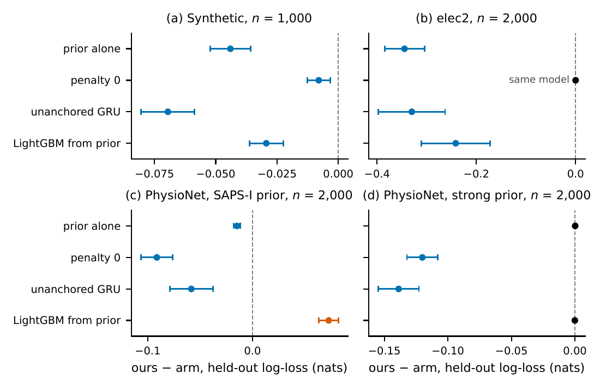
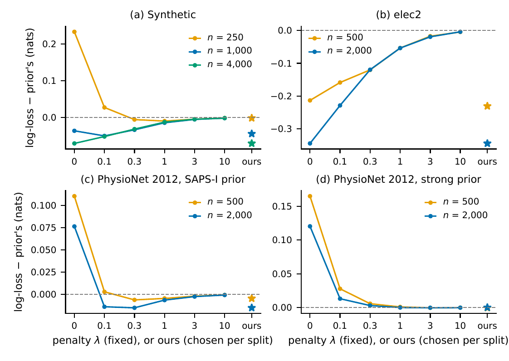
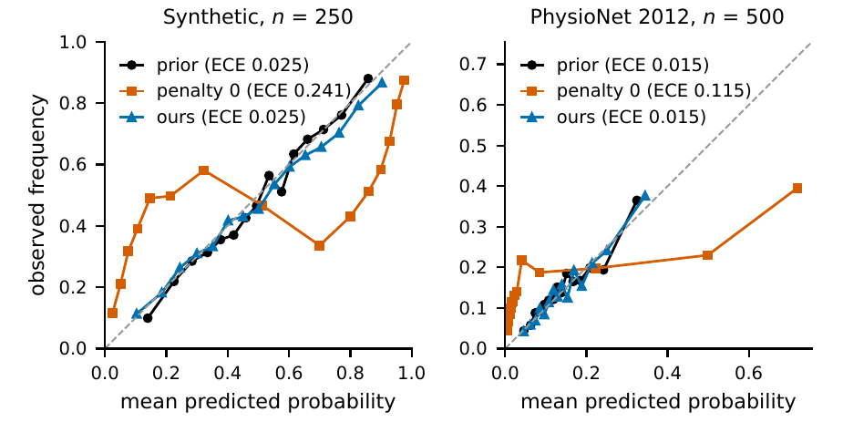

# anchorgru: a recurrent network that corrects a probability you already have

<p align="center">
  <a href="https://x.com/tr4m0ryp"></a>
</p>
<p align="center">
  <a href="paper/anchorgru.pdf"></a>
</p>

A small GRU that only adds a bounded, penalised log-odds correction to an existing probability **beat LightGBM
boosted from the same prior by 0.17 and 0.24 nats (SE 0.03, 0.04) on elec2**, where the prior is weak (a
current-row logistic fit, log-loss 0.56 against 0.67 for a constant). On **PhysioNet ICU mortality LightGBM from the
prior beats it by 0.05 and 0.07 nats**. The penalty's job is no harm: without it the same network is **0.11 nats
worse than the prior** on PhysioNet; with it the model beats or ties its prior in 12 of 13 settings and loses the
last by 0.0017 nats.

```bash
pip install git+https://github.com/tr4m0ryp/anchorgru
```

```python
from anchorgru import AnchoredGRUClassifier
# X: (n, steps, channels) history with NaN for missing; prior: a probability per row that never saw its label
clf = AnchoredGRUClassifier(penalty=1.0).fit(X, y, prior=prior)
p = clf.predict_proba(X_new, prior=prior_new)[:, 1]
print(clf.diagnostics_["residual_rms"])   # how far the network moved the prior, in log-odds
```

<details>
<summary>How the model works, in plain words</summary>

Picture an experienced doctor who gives every new patient a risk score at admission. You also have the hourly
measurements of the next two days. You could train a network on those measurements from scratch, but with a few
hundred patients it will relearn badly what the doctor already knew. Better: keep the doctor's score and let the
network only say "given how the night went, raise it a little" or "lower it a little".

That is the whole model. A probability is first moved onto the **log-odds** scale, `log(p / (1 - p))`, where 0 means
50 %, +2 about 88 % and -2 about 12 %. On that scale, adding a number is a clean way to push a probability up or down
without ever leaving the 0 to 1 range.

A **GRU** (gated recurrent unit, a standard network that reads a sequence one step at a time and keeps a memory) reads
each example's recent history. Missing values are filled with the last seen value, every channel is expressed
relative to its latest reading, and a 0/1 channel says which values were really measured. At the end of the sequence
the GRU's memory goes through one small output layer that produces the correction.

Three details keep the correction honest. The output layer **starts at exactly zero**, so before training the model
returns the prior unchanged. The correction is squeezed through `tanh` and multiplied by a **cap**, so it can never
move the log-odds by more than, say, 2.5. And when an example has too few real measurements, a **gate** switches the
correction off and the prior comes back.

The part that matters most is the **penalty**. Training minimises the usual cross-entropy plus `lambda` times the
mean squared correction. Weight decay shrinks the network's weights; this penalty shrinks the network's *answer*,
the distance from the prior, directly. A correction has to earn its size with evidence. Mathematically, at the population level, for
each input the best penalised correction points in the right direction but always stops short of the full move, and it is zero
where the prior is already calibrated.

`lambda` is picked on a held-out 20 % of the training rows from 0, 0.1, 0.3, 1, 3 and 10. When the history carries a
lot of signal (elec2), the holdout picks 0 (once 0.1) and the network is free. When it carries little (ICU mortality), it picks
0.3 or 1 and the model stays close to the prior.

What we found: the penalty nearly removes the failure mode of plain residual networks (being worse than the prior
they started from: one loss of 0.0017 nats in 13 settings) and makes them far more stable across random seeds. On
elec2, where the sequence holds what the weak prior lacks, the gain is large, but it comes from the anchored
residual: the holdout turns the penalty off there. On PhysioNet, boosted trees on per-variable summaries read the
history better than this small GRU.



</details>

## The method

For example $`i`$ with prior probability $`q_i`$, label $`y_i \in \{0, 1\}`$ and last GRU state $`h_{i,T}`$:

```math
b_i = \operatorname{logit} q_i, \qquad
r_i = c \tanh\!\left(w^{\top} h_{i,T} + \beta\right) v_i, \qquad
p_i = \sigma\!\left(b_i + r_i\right)
```

```math
\mathcal{L} = \frac{1}{n}\sum_{i=1}^{n} \operatorname{BCE}\!\left(y_i, p_i\right)
  + \lambda \, \frac{\sum_{i} r_i^{2}}{\sum_{i} v_i},
\qquad \operatorname{BCE}(y,p) = -y\log p - (1-y)\log(1-p)
```

$`w`$ and $`\beta`$ start at 0, so the untrained model equals the prior exactly (the ReZero idea applied to a
probability). $`c`$ is the cap and $`v_i \in \{0, 1\}`$ a validity gate: below a share of 0.25 observed steps the
example gets the prior back. The GRU reads each channel relative to its last observed value after a forward fill,
plus one 0/1 mask channel per value channel (the mask of GRU-D without its decay). With $`\lambda = 0`$ the loss is
plain cross-entropy and training matches an unpenalised loop bit for bit (tested).

The penalty acts on each example's offset $`r_i`$, not on the weights (where weight decay and L2-SP act). Read as a
maximum a posteriori fit it is a zero-mean Gaussian prior on the correction itself. At the population level, with
$`\mu = \Pr(y = 1 \mid \text{input})`$ and $`\lambda' = \lambda n / \sum_i v_i`$, the minimiser of
$`\mathbb{E}[\operatorname{BCE}(y, \sigma(b + r))] + \lambda' r^2`$ solves

```math
\sigma(b + r^{*}) + 2\lambda' r^{*} = \mu
```

so (i) $`r^{*} = 0`$ if and only if $`\sigma(b) = \mu`$, (ii) $`r^{*}`$ has the sign of $`\operatorname{logit}\mu - b`$,
and (iii) $`|r^{*}| < |\operatorname{logit}\mu - b|`$ otherwise. The penalised correction moves toward the calibrated
one and stops short of it (Lemma 1, proof in the [paper](paper/anchorgru.pdf), Appendix A). This is a population
statement, not a guarantee that a fitted model never does worse than its prior. $`\lambda`$ is chosen from
$`\{0, 0.1, 0.3, 1, 3, 10\}`$ on an inner 80 / 20 holdout (ties go to the larger value), then the model is refit on
all training rows.

**API:** `AnchoredGRUClassifier(hidden, cap, penalty, epochs, n_seeds, n_bags, calibration, ...)` with
`fit(X, y, prior=q)`, `predict_proba`, `residual` (the offsets), `valid` (the gate) and `diagnostics_`;
`point_in_time_windows` and `check_no_lookahead` build windows from a long table without future rows;
`BlockedTimeSplit` for time-ordered folds; `Calibrator` / `choose_calibration` for cross-fitted Platt or isotonic;
`anchorgru.tune.search` for a resumable two-stage random search; `save` / `load` with a checksum.

## Results

Three public tasks. **Synthetic:** a logistic prior on static features plus 3 random-walk channels of 24 steps, 20 %
missing; the true probability is known (Bayes log-loss 0.5044). **elec2** (OpenML 151): does the price end above its
24 h average; the prior is a logistic regression on the current row, refitted weekly on the previous 2,000 rows; the
sequence is the last 48 half-hours of 5 columns. **PhysioNet/CinC 2012:** in-hospital death from an hourly grid of 36
variables over 48 h; the prior is an out-of-fold logistic fit on the SAPS-I admission score.

Arms on the same rows, windows and seed: the **prior** alone; **penalty 0** (the same anchored model without the
change); an **unanchored GRU** (base-rate start, no cap, no penalty, the prior's log-odds as an input channel);
**LightGBM from prior** (`init_score` = prior log-odds, early stopping on the same inner holdout, per-variable
summaries on PhysioNet, the network's own flattened steps elsewhere). The paired difference against arm $`a`$ is

```math
\bar d = \frac{1}{n_{\text{test}}} \sum_{i} \left(\ell_i^{\text{ours}} - \ell_i^{a}\right), \qquad
\operatorname{SE} = s_d / \sqrt{n_{\text{test}}}
```

with each test example first averaged over 3 training subsamples; on elec2 the SE comes from a moving-block bootstrap
with one-week blocks (336 rows, 2,000 draws). Negative favours ours; **bold** is beyond 2 SE.

| task, n | prior | ours | ours - prior | ours - penalty 0 | ours - unanchored | ours - LightGBM from prior |
|---|---|---|---|---|---|---|
| Synthetic, 250 | 0.5954 | 0.5940 | -0.0015 (0.0029) | **-0.2341 (0.0079)** | **-0.3308 (0.0098)** | **-0.0062 (0.0030)** |
| Synthetic, 1,000 | 0.5954 | 0.5514 | **-0.0440 (0.0042)** | **-0.0080 (0.0024)** | **-0.0695 (0.0056)** | **-0.0294 (0.0035)** |
| Synthetic, 4,000 | 0.5954 | 0.5251 | **-0.0703 (0.0047)** | same model | **-0.0038 (0.0019)** | **-0.0264 (0.0030)** |
| elec2, 500 | 0.5598 | 0.3291 | **-0.2307 (0.0263)** | -0.0173 (0.0087) | **-0.9692 (0.0918)** | **-0.1738 (0.0269)** |
| elec2, 2,000 | 0.5598 | 0.2151 | **-0.3447 (0.0205)** | same model | **-0.3301 (0.0343)** | **-0.2416 (0.0353)** |
| PhysioNet, 500 | 0.3960 | 0.3916 | **-0.0045 (0.0007)** | **-0.1148 (0.0083)** | **-0.3074 (0.0170)** | **+0.0471 (0.0030)** |
| PhysioNet, 2,000 | 0.3960 | 0.3811 | **-0.0150 (0.0017)** | **-0.0913 (0.0076)** | **-0.0585 (0.0105)** | **+0.0726 (0.0047)** |

Held-out log-loss in nats; SE in brackets. "Same model" means the inner holdout chose $`\lambda = 0`$ on every
subsample. The pre-registered keep rule (a win over all four arms, each beyond 2 SE) holds on synthetic n = 1,000
only; elec2 misses only on penalty 0 (n = 500: 1.99 SE; n = 2,000: the same model). On PhysioNet the trees win.

**The elec2 gain needs care.** Its label is defined from the price over the last day, which the sequence holds and
the current-row prior never sees, so the prior is weak (AUC 0.81, ECE 0.094, log-loss 0.56 against 0.67 for a
constant). The fair comparison is LightGBM from the same prior on the same steps: ours wins by 0.17 and 0.24 nats.
The holdout chose penalty 0 on 5 of 6 elec2 subsamples, so the penalty adds little there, and the pre-registered
ablation penalty 0 with 10x weight decay beats ours at n = 500 by 0.030 (SE 0.012).

<p align="center"></p>

Paired difference ours minus arm with a 95 % interval. Blue left of zero favours ours, orange right of zero favours
the arm. Panel (b): on elec2 at n = 2,000 penalty 0 is the same model. Panel (d) uses a strong prior: LightGBM on
all 48 h summaries.

**The penalty is what prevents harm.** At $`\lambda = 0`$ the model lands above the prior on PhysioNet and on
synthetic n = 250; a moderate $`\lambda`$ pulls it back to or below the prior. On elec2 any positive $`\lambda`$
costs log-loss. The best strength drifts with n and with how much
signal the sequence holds, which is why it is chosen per split.

<p align="center"></p>

**It steadies training.** In 5-seed reruns at the smallest n, the unpenalised head sits at its cap on 44 % to 90 % of
training rows. Moving $`\lambda`$ from 0 to 1 cuts the seed-to-seed spread of predicted probabilities:

| task | spread, penalty 0 | spread, penalty 1 | ECE, penalty 0 | ECE, ours |
|---|---|---|---|---|
| PhysioNet, 500 | 0.099 | 0.014 | 0.116 | 0.017 |
| elec2, 500 | 0.035 | 0.006 | 0.049 | 0.030 |
| Synthetic, 250 | 0.157 | 0.020 | 0.245 | 0.030 |

<p align="center"></p>

**A strong prior is the hardest no-harm test.** With LightGBM on all 48 h summaries as the prior, ours ties it
(-0.0002 and +0.0002, SE 0.0002, at n = 500 and 2,000) while penalty 0 trails ours by 0.165 and 0.120 nats.

## When to use it

- **You have a probability per example and a history window per example:** fit `AnchoredGRUClassifier` with
  `prior=`; let the inner holdout pick `penalty`. The prior must not have seen the row's label: fit it out of fold
  on your training rows, or the network learns to undo the prior's overfit.
- **The history carries signal the prior lacks** (elec2): the gain there was large and the holdout freed the
  network. Compare against LightGBM from the same prior and against plain heavy weight decay before trusting it.
- **The prior is already strong or the history is irregular tabular data:** in our runs ours tied the prior, with
  one small loss (0.0017 nats). Also try LightGBM with `init_score` set to the prior's log-odds on per-variable
  summaries; on PhysioNet it won.

## Limits

- **The full win holds in one setting** (synthetic n = 1,000). On PhysioNet LightGBM from the prior stays ahead by
  0.047 and 0.073 nats; three variants to close the gap (a strong prior, a boosted-tree prior, 10x weight decay) did
  not. Every variant is in [`bench/results/SCOPE.md`](bench/results/SCOPE.md).
- **With 10x weight decay the unanchored GRU beats ours on PhysioNet 2,000** (0.3277 vs 0.3571): cap and penalty hold
  the model near a weak prior.
- **One small loss to the prior:** with a prior that cannot see the second day, ours is worse at n = 500 by 0.0017
  (SE 0.0008).
- **The elec2 gain rests on a weak prior and on the residual, not the penalty.** Penalty 0 with 10x weight decay,
  a pre-registered ablation, beats ours on 4 of 7 main rows (synthetic 250 and 1,000, elec2 500, PhysioNet 2,000).
- **Penalising the pre-activation instead:** a variant we tested separately (the head's pre-activation penalised
  instead of the offset) also steadied the heads but did not beat the plain bounded residual on PhysioNet.
- **Three tasks only.** Nothing here is claimed beyond synthetic, elec2 and PhysioNet 2012.
- **The SE covers test-sample noise only.** Over training subsamples, the synthetic n = 1,000 win over penalty 0 sits
  on the 2 SE boundary.
- **Cut for compute:** one network per arm (the package default is 5 seeds x 3 bags), sizes up to 2,000 (4,000
  synthetic), 3 repeats, no GRU-D arm, no weather task. No finite-sample guarantee and no novelty claimed for the
  zero start or the cap.

## Reproduce

Python 3.12.3, PyTorch 2.15.0 (CPU), NumPy 2.5.4, scikit-learn 1.9.1, LightGBM 4.7.0; 2 worker processes of 1 thread,
59 minutes for the whole benchmark. Data download to `$ANCHORGRU_DATA` (default `../_data`, outside the repository).

```bash
git clone https://github.com/tr4m0ryp/anchorgru && cd anchorgru
pip install -e ".[dev,bench]" matplotlib
pytest                                     # 175 tests: the lemma, the zero start, no lookahead, the estimator
python examples/quickstart.py              # one-minute synthetic demo with a penalty sweep
bash bench/run_all.sh                      # synthetic, elec2, PhysioNet 2012 and three variants
PYTHONPATH=. python bench/report.py        # every table
python paper/results/make_numbers.py       # every number in the paper
python paper/figures/make.py               # the figures
```

## Cite

```bibtex
@misc{ouallaf2026anchorgru,
  author       = {Ouallaf, Moussa},
  title        = {Anchored residual sequence models: a bounded, penalised correction on top of a prior},
  year         = {2026},
  howpublished = {\url{https://github.com/tr4m0ryp/anchorgru}},
  note         = {Software: anchorgru 0.1.0}
}
```

## License

anchorgru is **source-available**, licensed under the [PolyForm Noncommercial License 1.0.0](./LICENSE), **not** an
OSI open-source license.

- **You may** use, modify, fork, and share anchorgru freely for any **noncommercial** purpose, as long as you keep
  the copyright and `Required Notice:` lines (see [`NOTICE`](./NOTICE)) and credit *"anchorgru by Keygraph, Inc."*
- **You may not** sell it, bundle it into a paid product, or run it as a paid/hosted service **without a commercial
  license**.
- **Exception:** `paper/neurips_2026.sty` is the NeurIPS style file and stays under its own terms.

Copyright (c) 2026 Keygraph, Inc. Commercial licensing enquiries: see [`NOTICE`](./NOTICE).
